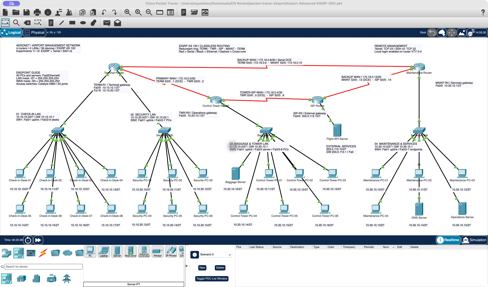

# AeroNet — Airport Network Lab

An interactive airport network simulator built with vanilla HTML, CSS, JavaScript and SVG, accompanied by native Cisco Packet Tracer projects.

**[Open the live website](https://aeronet-airport-lab-sb-1029.sayanbasu2006.chatgpt.site/)**

## Features

- Expanded airport with **36 devices and 36 links**: four routers, four switches, 24 PCs and four servers.
- Configure interfaces, IP addresses, subnet masks and gateways through forms or a simplified IOS console.
- Explore static/default routing, RIP v1/v2, single/multi-area OSPF, NAT/PAT, PPP, HDLC, BGP and EIGRP.
- Simulate Telnet and SSH login, VTY configuration and remote commands.
- Ping, traceroute, routing and neighbor tables, subnet calculation and packet animation.
- Demonstrate EIGRP failover with a redundant WAN ring.
- Responsive desktop, tablet and phone layouts, mobile navigation, device search, expanded workspace and dark/light themes.

## Run locally

Open `airport-network-lab/dist/index.html` in your browser. No backend or installation is required. Alternatively:

```sh
cd airport-network-lab
python3 -m http.server 4173 --directory dist
```

Then visit `http://localhost:4173`.

## Experiments

| Experiment | Topic |
| --- | --- |
| 1 | Commands and cable types |
| 2 | Peer-to-peer and LAN topologies |
| 3 | Router console and IOS configuration |
| 4 | IP addressing and subnetting |
| 5 | Static and default routing |
| 6 | Static NAT, dynamic NAT and PAT |
| 7 | RIP v1 and v2 |
| 8a / 8b | Single-area and multi-area OSPF |
| 9a / 9b | PPP and HDLC encapsulation |
| 10 | BGP autonomous systems and AS paths |
| 11 | EIGRP routing and WAN failover |
| 12 | Telnet and SSH remote management |

## Packet Tracer

Open [`Airport-Advanced-EIGRP-SSH.pkt`](packet-tracer-airport/Airport-Advanced-EIGRP-SSH.pkt) in Cisco Packet Tracer. The expanded project has an aligned layout with endpoint IP labels, LAN subnet/gateway headings and WAN interface mappings. Older foundation and OSPF projects are retained in the same folder.



## Demo login

For the browser remote-management lab: **admin / AirportLab123**. These are demonstration credentials for the educational simulation.

## Project files

| Path | Contents |
| --- | --- |
| `airport-network-lab/dist/` | Complete browser application |
| `airport-network-lab/tests/` | Networking model tests |
| `airport-network-lab/PROJECT-EXPLANATION.md` | Detailed project guide |
| `packet-tracer-airport/` | Native projects, diagrams and router configurations |
| `aeronet-airport-lab.zip` | Downloadable application source and documentation |
| `aeronet-deployment.tar.gz` | Static website files, ready to serve |

The website source is tracked directly in this repository, so a normal clone includes all application files.

## Model scope

This is an educational simulation. Browser protocols converge immediately; EIGRP uses fixed teaching costs instead of full DUAL, BGP models direct eBGP with AS paths, and SSH/Telnet sessions are local simulations without real sockets or cryptography. Native Packet Tracer projects are separate files.

## Optional development checks

```sh
cd airport-network-lab
npm run check
npm test
```

## Author

Sayan Basu
